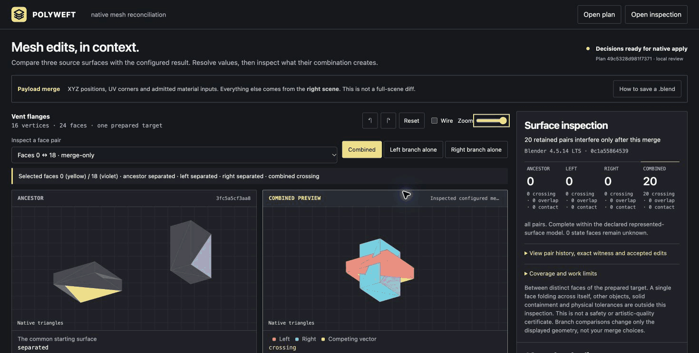
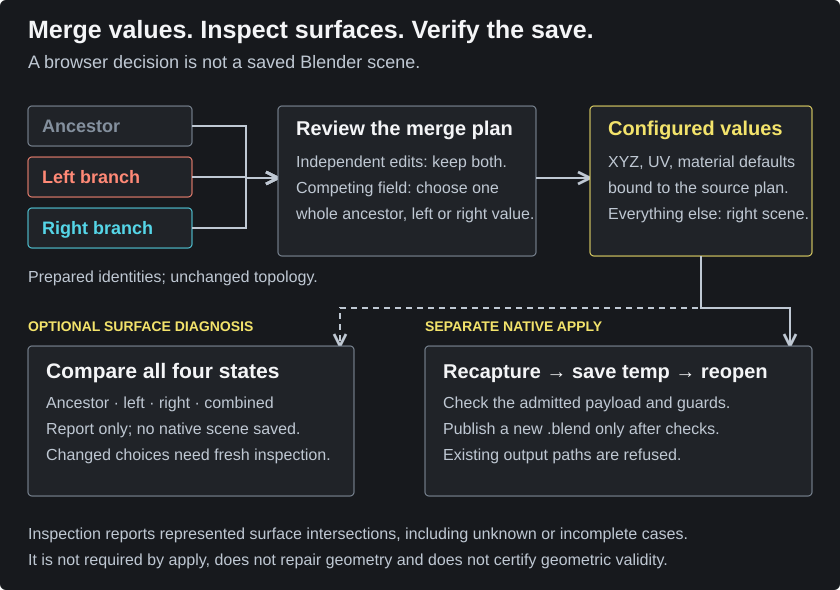
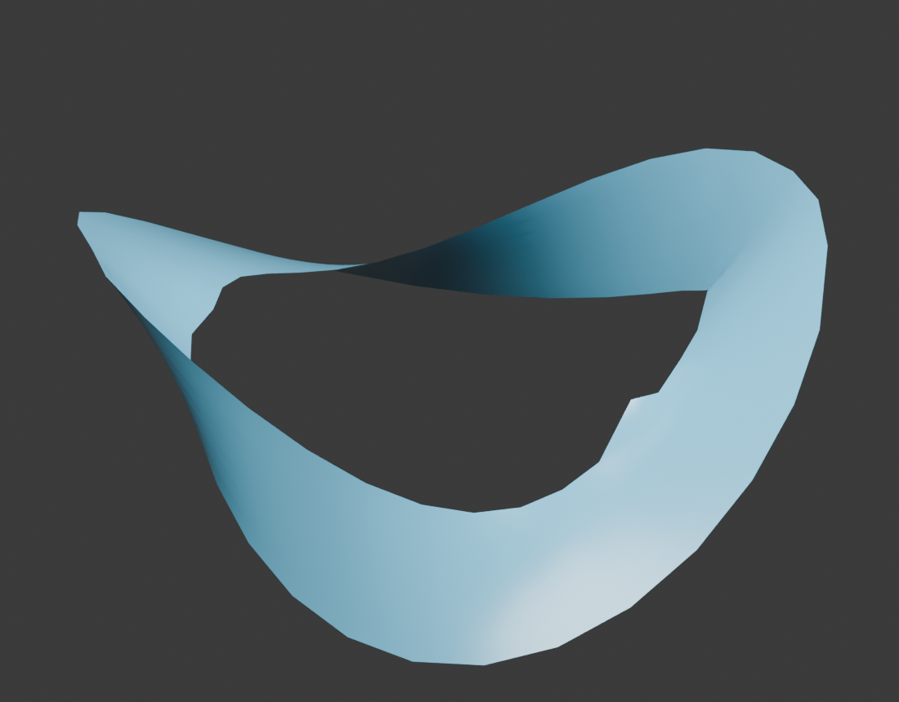

<p></p>

# Polyweft

**Merge Blender mesh edits. See what their combination creates.**

[](docs/VERIFICATION.md)
[](pyproject.toml)
[](docs/INTERFERENCE.md)
[](docs/CONTRACT.md)
[](https://github.com/nazeeh111/Polyweft/actions/workflows/verify.yml)
[](LICENSE)

Two artists can edit different vertices without a value conflict and still create crossing surfaces when their edits combine. Polyweft reconciles prepared native `.blend` branches, then traces the same face pair through ancestor, left, right and configured result.

**[Inspect the crossing-surface case →](https://nazeeh111.github.io/Polyweft/interference/)** · [Resolve competing edits →](https://nazeeh111.github.io/Polyweft/) · [Get the release](https://github.com/nazeeh111/Polyweft/releases)

<picture>
  <source media="(max-width: 650px)" srcset="docs/interference-mobile.gif">
  
</picture>

**Actual studio, recorded native data.** Flanges has 16 independent edits, zero competing values and 20 crossing face pairs after combination. The recording compares complete branches, then exposes one retained witness. It uses the published Blender 4.5.14 LTS inspection, not a new geometry measurement or a native write from the browser. [Four-state still](docs/interference-studio.jpg) · [Narrow view](docs/interference-mobile.jpg) · [Recording route and source identities](docs/PRESENTATION.md)

## Try the inspection

The linked studio works in your browser without installing Blender. Select a face pair; compare **Left branch alone**, **Right branch alone** and **Combined**; expand its history to see the native triangle witness and accepted vertex values. On narrow screens, use the **Ancestor / Left / Right / Combined** tabs for a full-width view.

For your own scenes, **prepare the ancestor before branching**. Native capture and saving need Python 3.11+, a trusted Blender executable, durable prepared identities and unchanged topology. Exported decisions are JSON, not a saved `.blend`. The right branch supplies the destination scene; everything outside the admitted payload comes from right.

## What you can do

Two artists start from one prepared mesh. One changes a rim and its UV seam; another changes the body profile and material color. Polyweft keeps both independent edits. If both change the same XYZ vector, UV corner or admitted material input, you choose the complete ancestor, left or right value. It never invents a coordinate by mixing axes.

The review displays actual captured geometry, UV corners and numerical values. Its combined mesh is a preview. Saving rechecks the inputs, recomputes decisions, invokes Blender, saves a fresh `.blend`, reopens it and checks the admitted payload before publishing the output.

## Work inside Blender · extension preview

The new native panel brings saved-file selection, whole-value choices, inspection and verified saving into Blender. It uses Blender's bundled Python, so the installed extension needs no pip, system Python or executable-path setup. Your active scene stays untouched. The browser becomes a read-only inspection snapshot; choices stay in the Blender panel.

This is an **unreleased preview**. The installed operator workflow is verified on Blender 5.1.2 for macOS arm64; hands-on panel acceptance is still pending. The released command-line workflow is below. [Verification status](docs/VERIFICATION.md#native-extension-preview)

From this source checkout, build the self-contained ZIP with Python 3.11+:

```sh
python tools/build_extension.py --output dist/polyweft-0.3.0.zip
```

Install it through **Preferences → Get Extensions → Install from Disk**, enable Polyweft, then open **3D View → Sidebar → Polyweft**.

1. Prepare a saved ancestor before branching, then choose the ancestor, left and right files.
2. Create a review and choose each competing whole value in the panel.
3. Inspect the four saved states in the read-only browser view.
4. Accept the limited payload scope and save to a new merged-copy path.

Changing a choice or a monitored source-file property revokes the inspection and scope acceptance. Saving always rechecks source hashes and native captures. The extension targets macOS arm64 and Linux x64 with Blender 4.5+ and its matching bundled standalone Python; Windows is unavailable. [Full native workflow, recovery and cancellation](docs/BLENDER.md)

## From review to native output

<picture>
  <source media="(max-width: 650px)" srcset="docs/merge-workflow-mobile.svg">
  
</picture>

Inspection diagnoses the configured surface; it neither saves a scene nor gates native apply. Changing a choice requires fresh inspection. Native apply independently checks the source-bound payload before publishing a new output. [Merge contract](docs/CONTRACT.md) · [Surface inspection limits](docs/INTERFERENCE.md)

## Run it

Python 3.11+ and a local Blender executable are required. Official Blender 4.5.14 LTS is tested on Linux in CI; a local Blender 5.3 Alpha build is also tested. Other runtime/platform combinations are not yet verified. No account, AI API, cloud service or Python runtime dependency is required. Install the release wheel, or from a source checkout:

```sh
python -m pip install .
```

For an installation without a source checkout, download the wheel from the release and run `python -m pip install /path/to/polyweft-0.2.1-py3-none-any.whl`.

Prepare a common ancestor **before** either artist branches:

```sh
polyweft prepare model.blend --object Shell --output base.blend --blender /path/to/blender
```

Save your edits as `left.blend` and `right.blend`, then capture and review:

```sh
polyweft plan base.blend left.blend right.blend --output review --blender /path/to/blender
polyweft studio review --port 6395
```

Open the loopback address printed by the studio, resolve each competing value, and export `decisions.json`. Save the result:

```sh
polyweft apply review --decisions decisions.json --output merged.blend \
  --accept-payload-scope --blender /path/to/blender
```

Download the **Blender 4.5 native Tide example** from the release assets, extract it, and run `polyweft plan` on its three branch files to create a local review. The public demo replaces machine paths with labels; it is for review, not direct native apply.

Inspect the configured combination before applying it:

```sh
polyweft inspect review --decisions decisions.json --output inspected --blender /path/to/blender
polyweft studio inspected --port 6395
```

Omit `--decisions` for a conflict-free review. Inspection recaptures the exact source files and builds the combined surface in memory, without saving a source scene. The output is a new read-only review bundle with `inspection.json`. It uses Blender's actual triangles separately in every state, including changes in how a quad or concave face is split. Keep the original report file unchanged for its checksum. Its recorded choices load into the studio; changing a choice immediately makes the inspection stale. Export the new choices and rerun `inspect` to obtain new evidence.

The original **Flanges** release bundle includes the three source files, a saved merged scene, fresh reopen evidence and complete corresponding software source. Its deliberate crossings demonstrate why independent field edits still need geometric review. The report records intersections; it does not edit the branch files. Revise an edit in Blender and capture a new plan when you want a different surface.

No conflicts? Omit `--decisions`. The output must be new. The command refuses unresolved conflicts, changed source bytes, manipulated plans, unsupported structure and existing output paths. Review directories can contain local paths and labels; inspect them before sharing.

## Native scene output



Tide demonstrates the separate vertex, UV and material reconciliation workflow and native scene output. The Flanges recording above demonstrates newly crossing surfaces. [Open Tide review](https://nazeeh111.github.io/Polyweft/) · [Native verification and limits](docs/VERIFICATION.md)

## Scope

| Admitted payload | Unit of reconciliation |
| --- | --- |
| Vertex positions | One complete XYZ vector per prepared vertex identity |
| UV coordinates | One complete UV pair per face-corner identity and UV layer |
| Material defaults | Admitted Principled Base Color and Roughness inputs |

**Everything outside this payload comes from right. This is not a whole-scene merge or an exhaustive scene diff.** Observed excluded changes appear in the review, but that list is not a complete inventory of every Blender feature.

The prepared target needs unchanged topology and durable identities. Linked data, shape keys, unsupported modifier/group structure, graph rewiring and structural target changes are refused. Polyweft does not infer correspondence in arbitrary unprepared scenes or merge topology edits. Geometry that combines cleanly can still intersect itself or produce an undesirable artistic result; inspect it in Blender.

Blender files are native binary projects. Auto-execution is disabled during loading, but Blender itself is not a sandbox for hostile files. Use trusted assets and a trusted Blender executable.

## Why this exists

Whole-file version control cannot keep two independent edits inside one shared binary mesh by choosing only one file. Blender link/append is useful for separate assets, but does not reconcile those edits. Polyweft owns a deliberately narrower native write-back workflow.

Mesh merging has substantial prior art. [MeshGit](https://gfx.cse.taylor.edu/projects/meshgit/meshgit-s13.pdf) is earlier research with more general topology correspondence. [BlenDiff](https://github.com/Vishrut2403/blendiff) compares a broader scene and documents mesh geometry as a manual write-back domain. Polyweft does not claim to invent mesh merging or replace either project's full scope. Its implementation and generated example are original; no third-party project code or evidence was copied.

## Verification

The 0.2 release workflow ran 32 Python checks, including real native Blender save/reopen, four-state surface capture and loopback HTTP boundaries, plus 13 Node preview/decision/inspection checks. Independent review compared 492 triangle pairs with a separate exact intersection test, checked native quad/ngon tessellation and repaired a display-coverage gap. Captured report bytes and complete/incomplete metadata are checked before browser display. The original merge review also checked published-file textures, shared mesh aliases, destination metadata and input bytes. The extension preview adds owned-process, cancellation, stale-choice, read-only snapshot and reproducible-package checks; its remaining acceptance gate is recorded separately.

See [the detailed evidence and limits](docs/VERIFICATION.md). Native verification establishes the declared supported payload, not artistic quality or geometric validity.

## Develop

```sh
python -m pip install .
python -m unittest discover -s tests -v
node --test tests/*.test.mjs
```

Set `POLYWEFT_BLENDER` to run the real native integration tests. Hosted release checks require the native tests to execute. See [contributing](CONTRIBUTING.md) for the evidence needed when changing admission or write-back.

Licensed [GPL-3.0-or-later](LICENSE). User artwork and data remain their authors' property.
