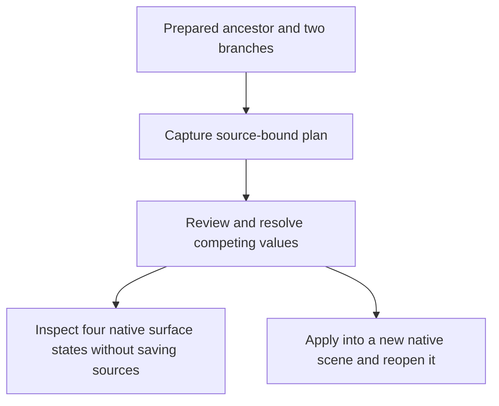

# Inspect the combination, not just the edits

The README recording uses actual local Polyweft studio captures of the published **Flanges** example. The source case has 16 independent vertex edits and no competing values. The recorded native inspection reports no crossings, overlaps or contacts in the three input states and 20 crossing face pairs in the configured result, within its declared represented-surface model.

[Open that case](https://nazeeh111.github.io/Polyweft/interference/) · [Inspection contract and limits](INTERFERENCE.md) · [Native validation](VERIFICATION.md)

## What to inspect

1. Select **Faces 0 ↔ 18**. Yellow and violet identify the same prepared faces in every view.
2. Compare **Left branch alone**, **Right branch alone** and **Combined**. These controls change only displayed geometry. They do not rewrite decisions or save a scene.
3. Expand **View pair history, exact witness and accepted edits**. The two retained witness endpoints for this pair are `(1/2, 1/2, -1/4)` and `(1/2, 3/4, -1/4)`. Accepted edits and their source hashes remain beside that witness. They are contributing edits, not a minimal causal set.
4. On a narrow screen, use the four state tabs for a full-width surface. **Combined** restores the configured combination after a branch-only comparison. An absent UV layer does not occupy an empty plotting panel.

The visible geometry is a browser projection of captured native triangles. Exact coordinates stay in the recorded report. Inspection completeness applies to distinct represented target faces, not physical clearance, containment, other scene objects or artistic quality. A partial zero count never establishes separation. Exported decisions do not write a `.blend`.

## Recorded input identity

The recording reuses the existing published Blender result. This presentation work does not establish a new native run or new numerical validation.

- Blender **4.5.14 LTS**, build `62c1db4208e8`.
- Plan `49c5328d981f737133ff0ecc446aa512c57fd2f127169c7700f2ca78cc7a2c9d`.
- Inspection `0c1a558645394928a83bf64c247824c3b40f5e70ff1fe942d835dcbf5f029dd2`.
- Published [plan JSON](https://nazeeh111.github.io/Polyweft/interference/plan.json), SHA-256 `74f5ec4d55634d5ff8630c563249a915c25721cda2f5dfce9c5be9b7fc61a385`.
- Published [inspection JSON](https://nazeeh111.github.io/Polyweft/interference/inspection.json), SHA-256 `97f92165a2f749bcae8584e1f1d61b727b04138365aef029365dcda4f81496a0`.

The immutable case identity is retained when local paths are redacted. Use the original report bytes for checksum validation. The current release bundles contain native files; regenerate a local plan against your own extracted paths before native apply.

## Recording and regeneration

The screenshots are retained under [captures/](captures/). They were captured from the actual loopback studio with Chrome, using the shared zoom control at 1.8 and the default camera. The mobile viewport was 390 × 844. The demonstration changes actual controls, not prerecorded geometry drawn into a mock interface. Pointer/focus and page-scroll changes are part of the recording.

Both GIFs encode four captured interface states and last 18 seconds. The desktop sequence compares configured result, left alone, right alone, then the witness. The mobile sequence displays ancestor, left, right and combined at full width. Frame duration is an editorial reading interval, not processing throughput or native simulation time. Static images provide a reduced-motion route.

To encode the retained captures again, use an environment with Pillow:

```sh
python tools/make_studio_walkthrough.py
```

`walkthrough-record.json` records the capture hashes, pixel dimensions and frame durations. The generator encodes actual captures; it performs no mesh computation. Browser/OS/font/Pillow differences can change new capture or GIF bytes.

To record a changed interface, first build a new portable studio using the source-bound plan/report and `tools/build_demo.py`. Operate the visible interface, capture each state separately, inspect the saved images and replace the matching capture set. Check the new desktop and narrow result before regenerating. Keep the native evidence files unchanged.

## Source behind the interface

[app.mjs](../src/polyweft/studio/app.mjs) loads the validated report, selects the same pair, projects its native geometry and displays accepted edits. [inspection.mjs](../src/polyweft/studio/inspection.mjs) validates report bytes and correspondence, and marks changed choices stale. [native.py](../src/polyweft/native.py) owns recapture, no-save inspection and separate native write/reopen. [interference.py](../src/polyweft/interference.py) owns the geometric predicates. The presentation revision changes no numerical or native contract.



Inspection and native apply are separate routes. The diagram does not make inspection a safety certificate or a mandatory gate implemented by apply.
