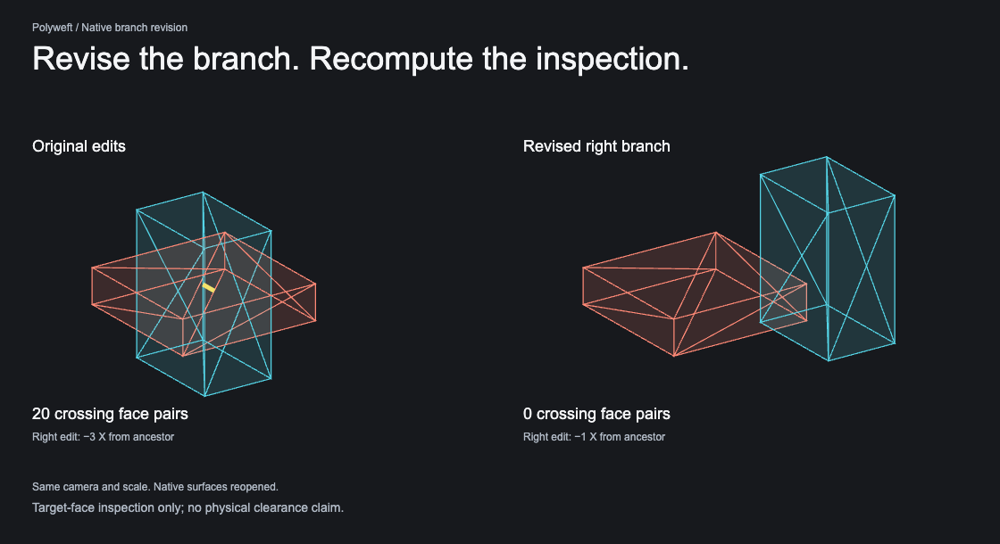

# Revise the branch. Recompute the inspection.

This is a fresh current-main native journey on Blender 5.1.2. It extends the original trusted Flanges example, whose 16 independent vertex edits combine into 20 crossing face pairs. There are no field-value conflicts to resolve: the geometry itself needs revision.

<picture>
  <source media="(max-width:650px)" srcset="revision-mobile.png">
  
</picture>

The original right branch moves its second component by −3 X from the prepared ancestor. The revised right file changes that net translation to −1 X. Left remains +2 X. All 16 vertices and 24 triangular faces retain their prepared identities/topology. The new plan still has 16 independent edits, then complete target-face inspection finds zero crossings, overlaps or contacts. Native apply and fresh reopen reproduce that exact inspected surface; original base/left/right bytes remain unchanged.

The diagram projects every native triangle with the same orthonormal camera and common horizontal/vertical scale per variant. It is an orthographic geometry view, not a measurement of physical clearance. Yellow marks the first original recorded witness between faces 0 and 18. Exact witness/provenance remains in [original inspection](crossing-inspection.json); the [revised inspection](revised-inspection.json) has no findings under its stated complete represented-face scope. [Camera/source mapping](figure-manifest.json) · [generator](figure.py) · [native receipts](receipt.json).

[Actual original desktop studio](crossing-1440.png) · [revised studio](revised-1440.png) · [original phone](crossing-375.png) · [revised phone](revised-375.png) · [actual browser-exported decisions](decisions.json).

## Reopen the native case

This is the extracted native case. Its BUNDLE.md, hashes and complete corresponding current-main software source are included. `python3 check.py` verifies the payload bytes, native source/output hashes and complete coordinate-to-SVG mapping. This is a stored-artifact reader, not a new native computation. Use a trusted Blender executable for a fresh actual replay:

```sh
PYTHONPATH=source/src python3 replay.py --blender /path/to/blender --output /tmp/new-polyweft-replay
```

The output path must be new. The replay recaptures the exact included base/left/right files, inspects both original and revised plans, applies the exact browser-exported decisions for revised, then freshly reopens and compares native surface arrays. New Blender file hashes may differ due native save/session metadata; the stored artifact hashes and newly replayed geometry are different checks. The actual native archive replay was executed before handoff. No installed extension, GUI control or native macOS file picker is claimed.

## Limits

Native apply is not gated by inspection. A user may deliberately save intersecting geometry; this case's original output does so. All source-bound payload admissions and right-destination behavior remain unchanged. These figures do not establish whole-scene safety, solid collision, artistic quality, physical clearance or general geometric correctness. The newer held Blender extension/managed workflow is separate and not included. Published GIFs/4.5 LTS evidence retain their original scope; this new case uses 5.1.2. GPL-3.0-or-later code and original synthetic artwork; no private scenes or fabric/hardware operations.
